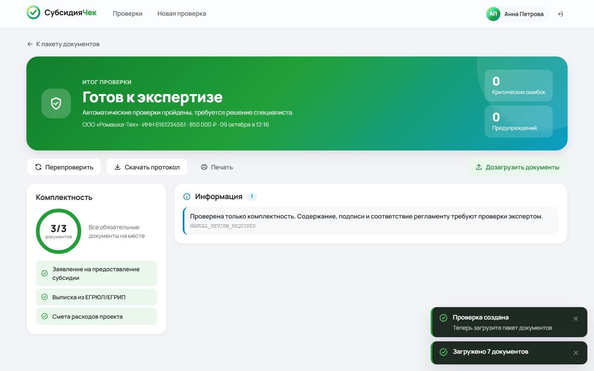
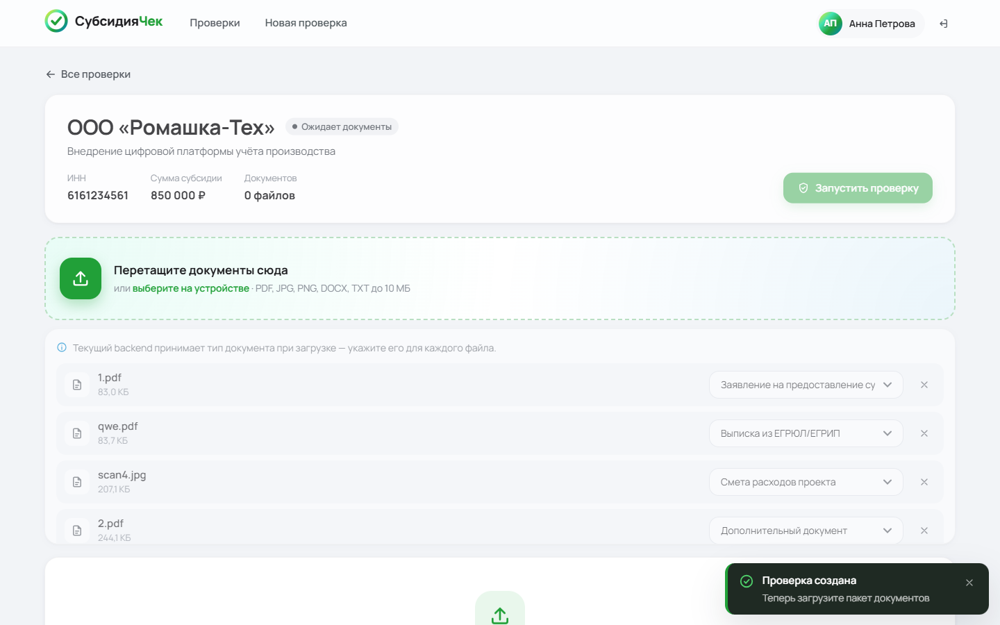
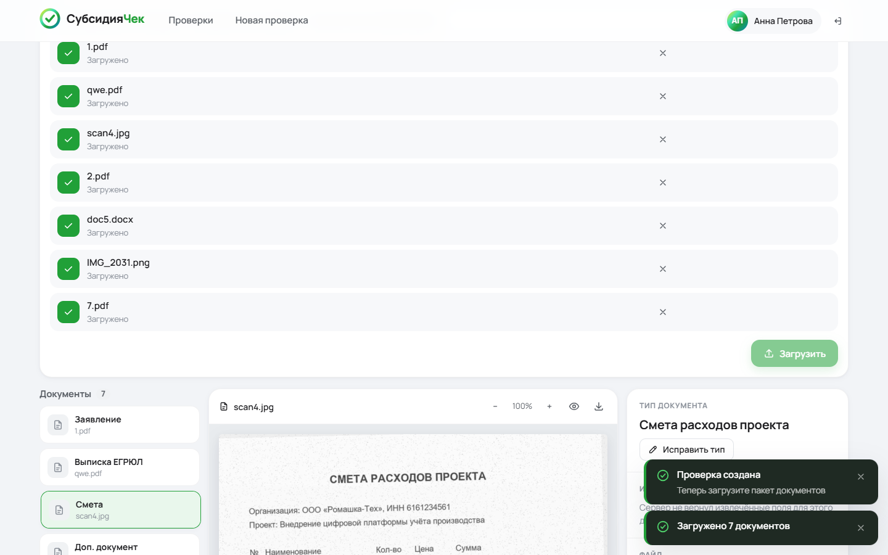

# Отчёт о тестировании backend на пакете документов

**Дата:** 09.10.2026 · **Стенд:** `sber-vibe/infra` (nginx + frontend + backend `671565e`) · **Автор:** nefot (frontend)
**Backend не изменялся.** Документ — список задач для backend-команды, у каждого пункта есть шаги воспроизведения и критерий «готово».

## Коротко

Прогон на реалистичном пакете из 7 документов и 7 пограничных файлов: **7 проверок из 26 пройдено, 19 нет**.

Текущий backend — каркас загрузки файлов и проверки комплектности по трём типам. Пакет с четырьмя заложенными ошибками
(нет согласия, сумма больше сметы, ИНН не совпадает, справка истекает) получает статус **«Готов к экспертизе», 0 ошибок, 0 предупреждений**:



Пять пунктов из списка **снятия с конкурса** сейчас выполняются (раздел P0). Их нужно закрыть первыми.

## Как воспроизвести

```sh
git clone --recursive https://github.com/sber-vibe/infra.git && cd infra
docker compose up -d --build
pip install reportlab pillow python-docx          # только для генерации пакета
python testdata/generate.py --today 2026-10-09    # пакет уже лежит в testdata/package, шаг нужен после правок генератора
python testdata/acceptance.py --base http://localhost --restart "docker compose restart backend"
```

`acceptance.py` использует только стандартную библиотеку. Результат печатается таблицей и пишется в `testdata/acceptance-result.json`.
Снимок этого прогона: [test-report/acceptance-2026-10-09.json](test-report/acceptance-2026-10-09.json).
**Критерий готовности backend — все проверки `acceptance.py` в статусе PASS.**

## Тестовый пакет

Организация вымышленная: ООО «Ромашка-Тех», ИНН `6161234561` (контрольная цифра корректна), запрошено **850 000 ₽**.
Имена файлов нейтральные, поэтому тип можно определить только по содержимому.
Правильные ответы для каждого файла лежат в [`testdata/package/expected.json`](../testdata/package/expected.json).

| Файл | Что внутри | Формат | Заложено |
|---|---|---|---|
| `1.pdf` | Заявление на субсидию | PDF с текстом | сумма 850 000 ₽ |
| `qwe.pdf` | Выписка ЕГРЮЛ | PDF с текстом | **ИНН `6161234562`** — расходится с заявлением |
| `scan4.jpg` | Смета расходов | скан JPG, наклон, шум | **итого 800 000 ₽** — меньше запрошенной суммы на 50 000 |
| `2.pdf` | Справка ФНС об отсутствии задолженности | **PDF-скан без текстового слоя** (нужен OCR) | **действует до 21.10.2026** — через 12 дней |
| `doc5.docx` | Бизнес-план | DOCX | — |
| `IMG_2031.png` | Банковские реквизиты | фото PNG, наклон | — |
| `7.pdf` | Доверенность | PDF с текстом | — |
| — | Согласие на обработку ПДн | — | **отсутствует** |

Пограничные файлы (`testdata/package/edge-cases/`):
- `Смета расходов (копия).PDF` — кириллица и расширение в верхнем регистре;
- `fake.pdf` — PNG под видом PDF;
- `empty.pdf`;
- `big.pdf` — 10,5 МиБ;
- `zayavlenie.pdf` — по имени заявление, внутри смета;
- `notes.txt`, `virus.exe`.

## Результаты

| ID | Требование | Проверка | Итог | Факт |
|---|---|---|---|---|
| A01 | Д1 | `/health` | ✅ | `200 {"status":"UP"}` |
| A02 | Д10 | Реестр содержит 8 видов документов | ❌ | 3 типа: `APPLICATION`, `REGISTRATION_EXTRACT`, `COST_ESTIMATE` |
| A03 | Д3 | Создание проверки | ✅ | 201 |
| A04 | **Д9** | Загрузка без `type`: тип определяет сервер | ❌ | `400 Required parameter 'type' is not present` |
| A05 | Д3 | Загрузка 7 файлов с ручным типом | ✅ | 201 для всех форматов, включая DOCX и PDF-скан |
| A06 | Д10 | Каждый вид можно указать или распознать | ❌ | справка ФНС, бизнес-план, реквизиты и доверенность загружены как `SUPPORTING_DOCUMENT` |
| A07 | **Д5** | Есть результат модели: тип, confidence, поля | ❌ | у документа только `id, type, filename, size, uploadedAt` |
| A08 | Д11 | Нет согласия → `MISSING_DOCUMENT` | ❌ | согласия нет в списке обязательных |
| A09 | **Д11** | 850 000 > 800 000 → `AMOUNT_GT_COST` | ❌ | в отчёте только `MANUAL_REVIEW_REQUIRED` |
| A10 | бонус | ИНН заявления ≠ ИНН выписки → `INN_MISMATCH` | ❌ | нет |
| A11 | бонус | Справка истекает через 12 дней | ❌ | нет |
| A12 | Д11 | Статус пакета с ошибками | ❌ | `REVIEW_REQUIRED` |
| A13 | **Д4** | Данные после перезапуска backend | ❌ | `404 Application not found` |
| A14 | баллы | Исправление типа и полей (`PATCH`) | ❌ | `405 Method 'PATCH' is not supported` |
| A15 | Д3 | Оригинал с исходным именем и типом | ❌ | `application/octet-stream`, `filename="<uuid>.bin"` |
| A16 | баллы | Оригинал закрыт без авторизации | ❌ | `200`, файл отдаётся любому, кто знает id |
| A17 | Д3 | `Смета расходов (копия).PDF` | ✅ | 201, имя сохранено |
| A18 | Д3 | `empty.pdf` | ✅ | 400 |
| A19 | Д3 | `big.pdf` 10,5 МиБ | ✅ | 413 |
| A20 | Д3 | `virus.exe` | ✅ | 415 |
| A21 | Д3 | `fake.pdf` (PNG) | ❌ | 201: содержимое не проверяется |
| A22 | **Д9** | `zayavlenie.pdf` со сметой внутри | ❌ | 400: тип обязан прислать клиент |
| A23 | Д1 | Одна проверка не блокирует остальные | ❌ | после 5 файлов по 9 МБ **все** проверки получают `413 Demo storage limit exceeded` |
| A24 | баллы | ИНН с неверной контрольной цифрой | ❌ | `1234567890` принят |
| A25 | баллы | Сумма с долями копейки | ❌ | `850000.555` принята |
| A26 | баллы | Ошибка валидации указывает поле | ❌ | `400 Invalid request content.` без имени поля |

## Задачи для backend

### P0 — снятие с конкурса или недопуск

**B1. Тип документа задаёт клиент, а не модель по содержимому (Д5, Д9)** — A04, A07, A22.
Сейчас `type` — обязательный параметр загрузки (`ApplicationController.java:45`), сервер его не проверяет.
Положение запрещает определять тип по имени, расширению или выбору пользователя.
- **Сделать:** `type` в `POST /documents` необязателен. Сервер извлекает текст (текстовый слой PDF, OCR для сканов и изображений) и вызывает AI provider. В ответе возвращает `detectedType`, `confidence` и `processingStatus`.
- **Учесть:** `2.pdf` — скан без текстового слоя, его текст можно получить только через OCR.
- **Готово:** A04 и A22 проходят; `zayavlenie.pdf` распознан как `COST_ESTIMATE`.

**B2. Нет извлечения полей (Д5)** — A07.
- **Сделать:** в `DocumentView` добавить `fields: [{name, value, confidence, manuallyCorrected}]`. Минимальный набор: `company_name`, `inn`, `requested_amount`, `total_cost`, `director`, `date`, `valid_until`.
- **Готово:** значения для пакета совпадают с `expected.json`. Сверять нужно на этом и других пакетах: подгонять извлечение под конкретные файлы запрещено.

**B3. Правила и арифметика не выполняются, статус вводит в заблуждение (Д11)** — A08–A12.
`check()` проверяет только наличие трёх типов (`ApplicationService.java:16`, `:104–106`).
Полный по составу пакет получает `REVIEW_REQUIRED`, даже если суммы и ИНН противоречат друг другу.
- **Сделать** правила на сервере:
  - обязательные и условные документы, включая согласие на обработку ПДн;
  - `requested_amount ≤ total_cost`;
  - равенство ИНН между документами;
  - срок действия `valid_until` относительно даты проверки;
  - обязательные поля.
- **Сделать** у `Finding` поля `severity` (`ERROR | WARNING | INFO | OK`) и `documentId`. Успешные проверки отдавать с `OK`: интерфейс показывает их в блоке «Успешные проверки».
- **Сделать** итоговый статус: при любой ошибке `ERROR` пакет требует доработки, а не `REVIEW_REQUIRED`.
- **Готово:** для пакета находятся 4 замечания из `expected.json → planted_findings`, статус — «требует доработки».

**B4. Данные хранятся в памяти процесса (Д4)** — A13.
`private final Map<UUID, ApplicationState> applications` (`ApplicationService.java:18`): после `docker compose restart backend` проверки исчезают. Это прямой пункт снятия.
- **Сделать:**
  - PostgreSQL с миграциями (сервис и volume в `infra/docker-compose.yml` — задача Infra, можно поручить мне);
  - оригиналы файлов на отдельном volume или в объектном хранилище, в БД только ссылки;
  - сохранять отчёты, исправления специалиста и сведения о вызове модели.
- **Готово:** A13 проходит.

**B5. Восемь видов документов (Д10)** — A02, A06.
`DocumentType` — enum из четырёх значений.
- **Сделать:** конфигурируемый реестр типов: список, обязательность, условия и поля задаются конфигурацией, а не кодом. `GET /document-types` должен отдавать все типы с признаком обязательности. Сейчас отдаёт только обязательные, и фронт не знает остальных.
- **Готово:** A02 и A06 проходят. Официальный перечень заменяет демо-типы без правки кода.

### P1 — баллы и рабочее место специалиста

**B6. Исправление типа и полей специалистом** — A14.
Фронт уже отправляет запросы:

```http
PATCH /api/v1/applications/{id}/documents/{documentId}
{"type": "REGISTRATION_EXTRACT"}
{"fields": [{"name": "inn", "value": "6161234561"}]}
→ 200 DocumentView (с manuallyCorrected: true у изменённых полей)
```

- **Сделать:** сохранять автора и историю изменений, сбрасывать или пересчитывать отчёт.
- **Учесть:** пока сервер отвечает 405, фронт меняет тип обходным путём — скачивает файл, загружает заново с новым типом и удаляет старую запись. При этом теряется история.

**B7. Оригинал без исходного имени и типа** — A15.
`Content-Disposition: filename="<uuid>.bin"` и `application/octet-stream` (`ApplicationController.java:54–55`). Скачанный файл называется `….bin`, браузер не открывает его без обходных приёмов фронта.
- **Сделать:**
  - `Content-Type` определять по сигнатуре содержимого;
  - `Content-Disposition: inline; filename*=UTF-8''<исходное имя>`;
  - сохранить `X-Content-Type-Options: nosniff`.

**B8. Оригиналы доступны без авторизации** — A16.
Любой, кто знает пару UUID, получает файл. По плану — Keycloak/JWT (Phase 7).
- **Готово:** без токена `401`, с чужим токеном `403`.

**B9. Общий лимит хранилища блокирует всех пользователей** — A23.
`MAX_TOTAL_SIZE = 50 МиБ` на весь процесс (`ApplicationService.java:15`, `:51`, `:64`). Пять сканов по 9 МБ в одной проверке — и никто не может загрузить файл ни в одну проверку. То же с лимитом 100 проверок на процесс (`:26`). На защите это остановит демо.
- **Сделать:** убрать глобальные лимиты вместе с переходом на постоянное хранилище (B4) либо сделать лимит на проверку. Сообщение в ошибке — по-русски.

**B10. Содержимое файла не проверяется** — A21.
Тип проверяется только по расширению (`ApplicationService.java:59`): PNG с именем `.pdf` принят.
- **Сделать:** проверять сигнатуру (`%PDF`, `\x89PNG`, `\xFF\xD8\xFF`, ZIP для DOCX). Несовпадение — `415` или обработка по фактическому формату.
- **Учесть:** TXT принимается, хотя в MVP заявлены PDF/JPG/PNG. Оставить осознанно или убрать.

### P2 — качество

**B11. Валидация заявки** — A24–A26.
- **ИНН:** проверять контрольные цифры (10 и 12 знаков). Сейчас `1234567890` проходит (`Models.java:15`).
- **Сумма:** ограничить точностью 2 знака (`@Digits(integer=15, fraction=2)`), `NUMERIC` в БД (`Models.java:17`).
- **Ошибки:** Problem Details с перечнем полей, например `"errors": [{"field": "inn", "message": "..."}]`. Сейчас фронт не может подсветить поле по ответу сервера.

**B12. Тексты ошибок.**
`detail` приходит по-английски (`Application not found`, `Demo storage limit exceeded`). Фронт переводит известные строки, но новые будут показаны как есть. Лучше сразу отдавать русский `detail` или стабильный `code`.

## Контракт, который уже поддерживает frontend

Все поля необязательные: фронт показывает их, как только backend начинает их отдавать.

```jsonc
// DocumentView
{
  "id": "uuid", "type": "APPLICATION | null", "filename": "1.pdf", "size": 85026, "uploadedAt": "…",
  "detectedType": "APPLICATION", "confidence": 0.94, "processingStatus": "PENDING | PROCESSING | DONE | FAILED",
  "fields": [{ "name": "inn", "value": "6161234561", "confidence": 0.9, "manuallyCorrected": false }]
}
// Finding
{ "code": "AMOUNT_GT_COST", "message": "…", "documentType": "COST_ESTIMATE", "severity": "ERROR", "documentId": "uuid" }
```

- Порог `confidence`, ниже которого показывается «Тип документа требует подтверждения специалиста», задаётся во фронте переменной `NEXT_PUBLIC_CONFIDENCE_THRESHOLD`.
- Когда B1 будет готов, в `infra/.env` выставить `NEXT_PUBLIC_AUTO_CLASSIFY=true`: фронт перестанет отправлять `type` при загрузке.

## Что работает

- Создание проверки и загрузка всех форматов пакета, включая DOCX и сканы.
- Кириллица в имени файла сохраняется.
- Пустой, слишком большой и неподдерживаемый файлы отклоняются правильными кодами в формате Problem Details.
- Отчёт сбрасывается после загрузки или удаления документа.
- `/health` отвечает.

## Замечание по frontend (моя зона)

Для статуса `REVIEW_REQUIRED` интерфейс пишет «Автоматические проверки пройдены». При текущем backend, где проверяется только комплектность, это звучит сильнее, чем есть на самом деле. Поправлю формулировку или стану опираться на `severity`, когда появится B3.

## Скриншоты

| Загрузка: тип выбирает специалист | Смета-скан: полей нет | Итог: пакет с ошибками «готов» |
|---|---|---|
|  |  |  |
